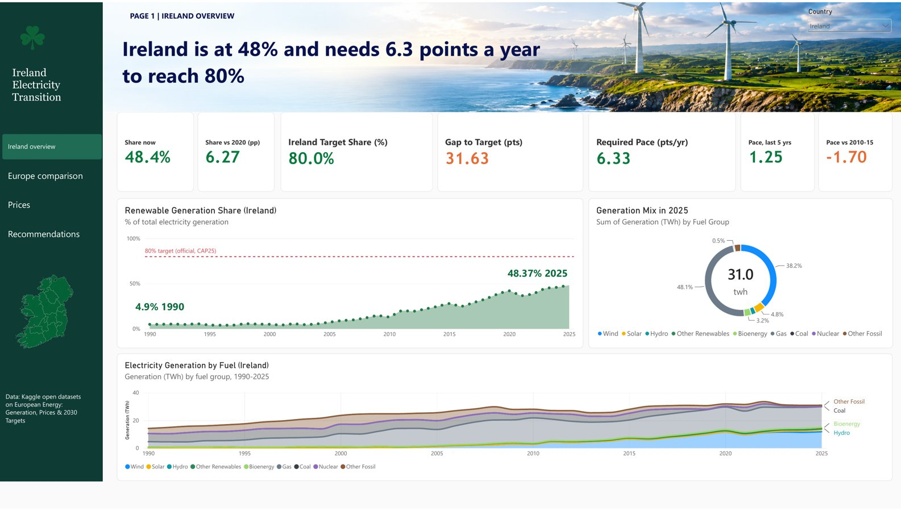
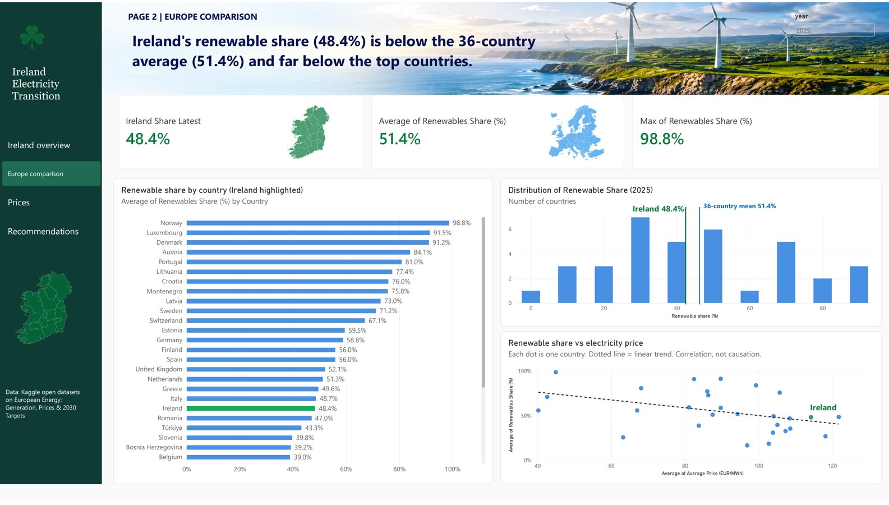
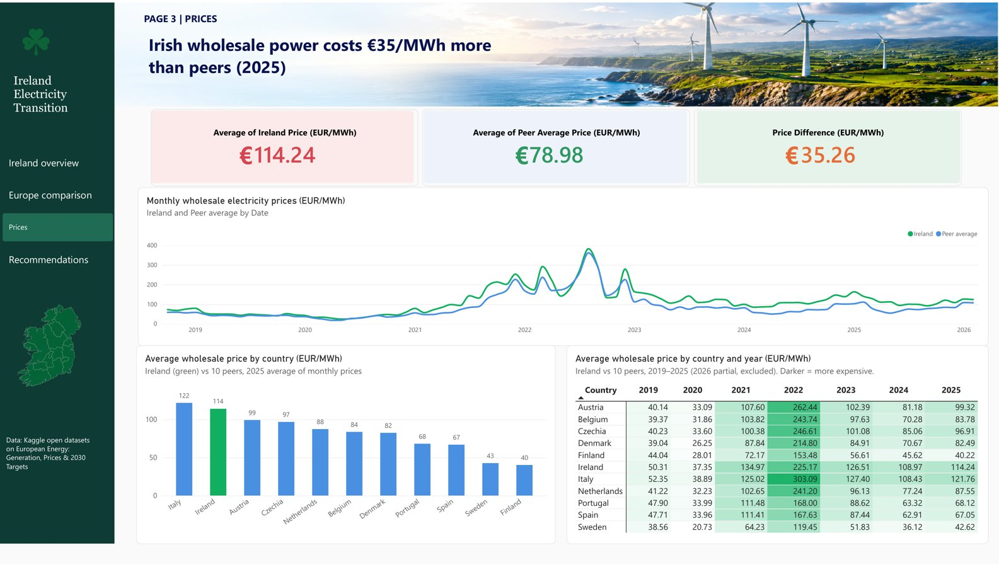
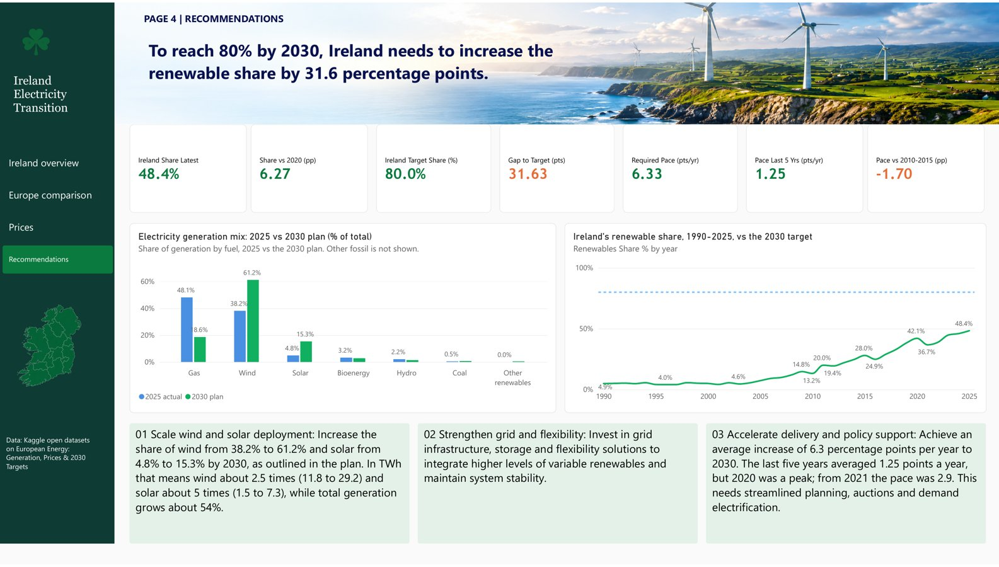

# Ireland Electricity Transition

> **Can Ireland's grid reach 80% renewable electricity by 2030?** A Power BI analysis of Ireland's electricity mix, its position in Europe, and wholesale prices against peer countries.


A group project for **BAA1113 – Statistics, Visualization & Communication**, MSc Business Analytics, Dublin City University (Group 9).



---

## Table of contents

- [Headline findings](#headline-findings)
- [The question](#the-question)
- [Dashboard pages](#dashboard-pages)
- [Repository structure](#repository-structure)
- [Getting started](#getting-started)
- [Data](#data)
- [Method and measures](#method-and-measures)
- [Limitations](#limitations)
- [Recommendations](#recommendations)
- [Team](#team)
- [Licence, citation and acknowledgements](#licence-citation-and-acknowledgements)

## Headline findings

| Indicator | Value |
|---|---|
| Renewable share of Irish generation, 2025 | **48.4%** |
| Target share, 2030 (generation basis, Climate Action Plan 2025) | 80% |
| Gap to target | 31.63 percentage points |
| Required pace, 2025–2030 | **6.33 points a year** |
| Achieved pace, 2020–2025 | 1.25 points a year (about 5.1× slower than required) |
| Ireland's rank in Europe | 20th of 36 countries (country average 51.4%) |
| Irish wholesale price, 2025 | €114.24/MWh |
| Ten-country peer average, 2025 | €78.98/MWh |
| Irish price premium | **€35.26/MWh (44.6%)** |
| Correlation, renewable share vs price, 2025 (31 countries) | r = −0.39 (pooled observations: r ≈ 0.006) |

**In short:** the gap is about *pace*, not direction. At the recent 1.25-point rate Ireland would reach roughly 55% by 2030; at the faster post-2020-low rate of 2.9 points a year, roughly 63%. Both fall well short of 80%. A higher renewable share is not, on this evidence, an automatic route to cheaper wholesale power, so affordability needs to be tracked as its own objective.

## The question

Ireland is an island grid with strong wind resources, but gas still supplied 48.1% of generation in 2025. The analysis is organised around four questions:

1. Where is Ireland today, and how fast has its renewable share grown?
2. How does Ireland compare with other European countries?
3. Are Irish wholesale prices out of line with peers, and does a higher renewable share bring lower prices?
4. What pace and fuel mix does the 2030 target require?

## Dashboard pages

| Page | Focus | Preview |
|---|---|---|
| 1. Ireland overview | Renewable share 1990–2025, generation by fuel, KPI cards for gap and required pace |  |
| 2. Europe comparison | Ranking of 36 countries, distribution of shares, share vs price scatter |  |
| 3. Prices | Ireland vs ten peers, monthly and annual, 2019–2025 |  |
| 4. Recommendations | 2025 mix vs 2030 plan, pace comparison, four recommendations |  |

## Repository structure

```text
Ireland-Electricity-Transition-/
├── README.md
├── LICENSE
├── CITATION.cff
├── .gitignore
├── .gitattributes
├── dashboard/
│   ├── Ireland_Electricity_Transition.pbix            # Power BI report (open in Power BI Desktop)
│   └── Ireland_Electricity_Transition_Dashboard.pdf   # Static export of all four pages
├── report/
│   └── Ireland_Electricity_Transition_Report.docx     # Written group report
├── presentation/
│   └── Ireland_Electricity_Transition_Presentation.pptx   # 16-slide deck
├── data/
│   ├── model/ireland_powerbi_model_data.xlsx          # Cleaned, modelled tables used by the dashboard
│   └── raw/                                           # Original Kaggle/Ember files (see data/raw/README.md)
├── docs/
│   ├── methodology.md
│   ├── data-dictionary.md
│   └── measures.md
└── assets/screenshots/                                # Images used in this README
```

## Getting started

**Requirements:** [Power BI Desktop](https://powerbi.microsoft.com/desktop/) (Windows). Power BI Desktop is not available natively on macOS or Linux; use a Windows machine or VM, or read the PDF export.

1. Clone the repository:
   ```bash
   git clone https://github.com/shreyas2632/Ireland-Electricity-Transition-.git
   ```
2. Open `dashboard/Ireland_Electricity_Transition.pbix` in Power BI Desktop.
3. If prompted, refresh the data. The model is self-contained in the file, so a refresh is only needed if you change the source tables.
4. No Power BI? Open `dashboard/Ireland_Electricity_Transition_Dashboard.pdf` for a static view.

## Data

Data originates from **Ember** open datasets, accessed via a Kaggle compilation:

- Ashik, Khalid. *European Energy: Generation, Prices & 2030 Targets*. Kaggle, 2026. <https://www.kaggle.com/datasets/dkhalidashik/european-energy-generation-prices-and-2030-targets>
- Ember, *Yearly Electricity Data* and *European Wholesale Electricity Price Data* (<https://ember-energy.org/data/>).

The cleaned model in `data/model/ireland_powerbi_model_data.xlsx` contains these tables:

| Sheet | Contents |
|---|---|
| Countries | 37 countries/aggregates with flags for generation data, price data and peer group |
| Yearly Generation | Generation and share by fuel, by country and year (1990–2025) |
| Generation Mix | Long-format fuel generation (TWh) |
| Monthly Prices | Monthly wholesale prices (EUR/MWh) by country |
| Yearly Prices | Annual average prices and months of coverage |
| Country Scatter | Renewable share joined to average price by country-year |
| Ireland vs Peers Monthly | Irish price vs ten-peer average, monthly |
| Targets 2030 | 2030 renewable targets by country, with basis and notes |
| Ireland 2030 Fuel Shift | 2025 shares vs the 2030 plan scenario |

Full column descriptions: [`docs/data-dictionary.md`](docs/data-dictionary.md). Original source files: [`data/raw/`](data/raw/README.md).

## Method and measures

Source tables were loaded into Power BI, linked through a country dimension (ISO3 code) and a date/year key, and analysed with DAX measures for renewable share, gap to target, required annual pace, recent pace and price difference. Chart types follow the question: area and line charts for trends, bars for ranking, a histogram for distribution, scatter plots for relationships. Green highlights Ireland and positive results; blue marks gaps.

See [`docs/methodology.md`](docs/methodology.md) and [`docs/measures.md`](docs/measures.md).

## Limitations

- 2025 generation figures may be provisional; wholesale price data ends in February 2026.
- The 80% target in the dashboard is on a **generation** basis and is not identical to the official policy definition.
- The 51.4% European figure is a simple average of country shares; Ember's generation-weighted EU estimate for 2025 was about 48%.
- Prices are **wholesale**, not retail bills, and the peer group is ten countries.
- The 2030 plan scenario is a benchmark, not a forecast. Correlation is not causation.

## Recommendations

1. **Scale wind and solar:** raise wind from 38.2% to 61.2% and solar from 4.8% to 15.3% of generation (the 2030 plan scenario).
2. **Strengthen grid and flexibility:** interconnection and flexibility to handle variable supply.
3. **Accelerate delivery:** grid connections, planning approvals and auction timelines.
4. **Treat affordability separately:** investigate gas exposure, market design and network costs behind the €35.26/MWh premium.

## Team

Group 9, MSc Business Analytics, Dublin City University:

- Shreyas Patil
- Sanjana Mahabal
- Soham Gode
- Sayali Chavan
- Aditya Kadam

## Licence, citation and acknowledgements

Original work in this repository (documentation, report, presentation, dashboard design) is released under the [MIT Licence](LICENSE). **Underlying data remains subject to the licences of Ember and the Kaggle dataset author;** check those terms before redistributing the raw data.

If you use this work, see [`CITATION.cff`](CITATION.cff) or use GitHub's "Cite this repository" button.

Thanks to Ember for open energy data, to the Kaggle dataset author, and to the DCU BAA1113 teaching team.

> This repository is a university group project shared for portfolio purposes. If you are a student on a similar module, use it for learning, not as submission material.
